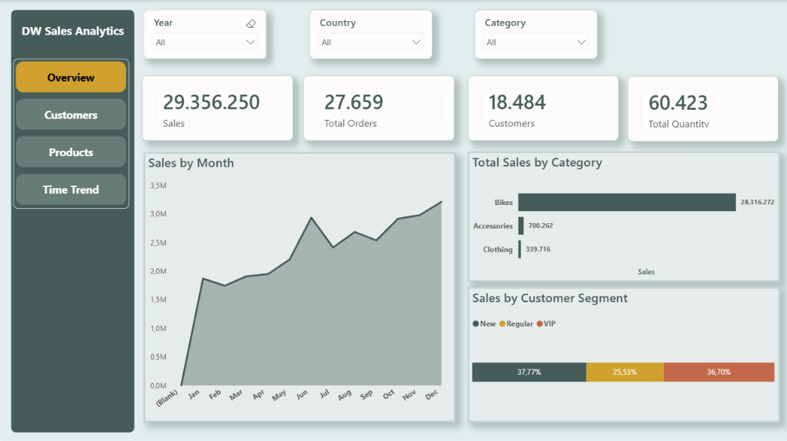
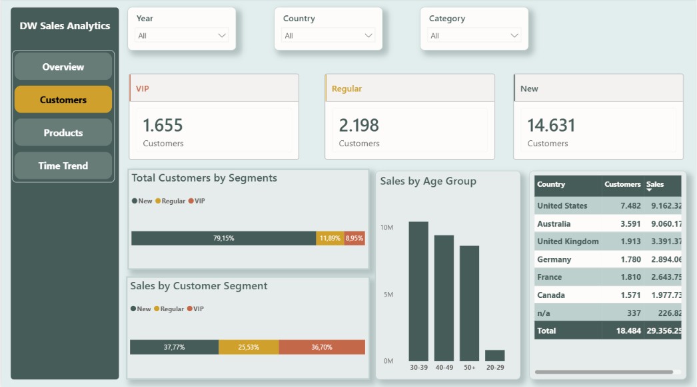
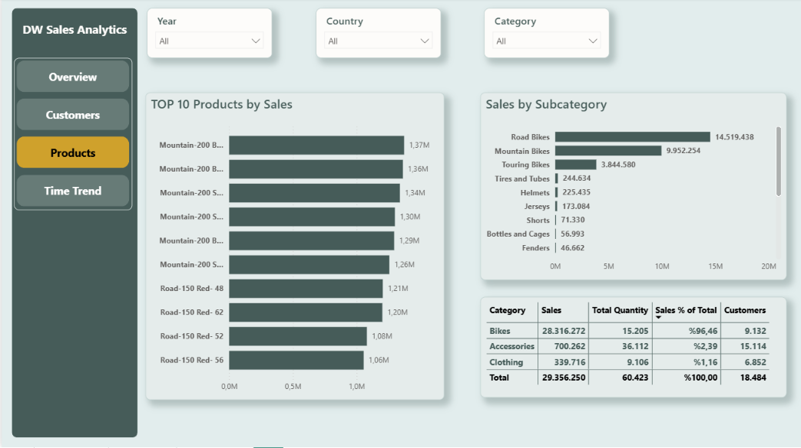
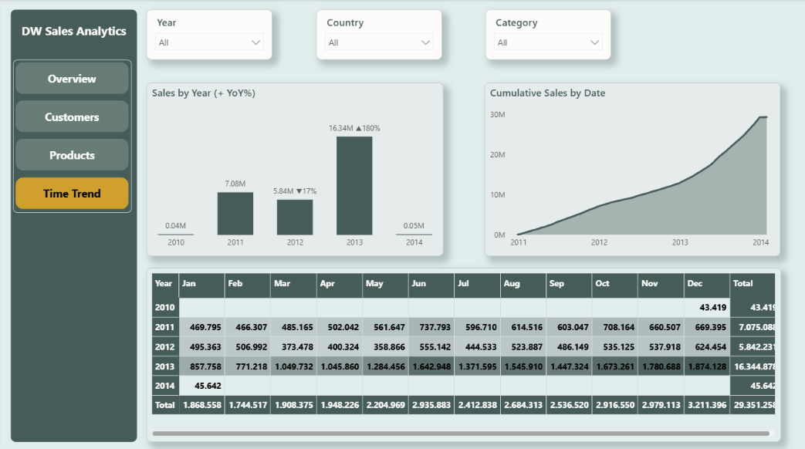

# Data Warehouse Analysis

A sales analytics project built with **SQL Server** and **Power BI**. It analyzes 60,398 order lines from 18,484 customers (Dec 2010 – Jan 2014) on the Gold layer (star schema) of my [SQL Data Warehouse project](https://github.com/yucakd/sql_data_warehouse_projects) to show who buys, what sells, and how sales change over time.

## Power BI Dashboard

A four-page interactive report with Year, Country and Category filters on every page. The file is in the repository: [`DW_Analysis_Dashboard.pbix`](DW_Analysis_Dashboard.pbix).

### Overview
Total sales, orders, customers and quantity, sales by month, sales by category and sales by customer segment.

### Customers
VIP, Regular and New segments, customers and sales by segment, sales by age group and a country table.

### Products
Top 10 products, sales by subcategory and a category performance table.

### Time Trend
Sales by year with year-over-year growth, cumulative sales and a year-by-month matrix.

## Key Figures

| Metric | Value |
|---|---|
| Total sales | 29,356,250 |
| Total orders | 27,659 |
| Order lines | 60,398 |
| Total quantity sold | 60,423 |
| Customers | 18,484 |
| Products sold | 130 (of 295 in the catalog) |

## Data Model

Star schema with one fact table and three dimensions, loaded from the CSV files in `datasets/`.

| Table | Rows | Description |
|---|---|---|
| `fact_sales` | 60,398 | Order lines: order, ship and due dates, sales amount, quantity, price |
| `dim_customers` | 18,484 | Customer demographics: name, country, marital status, gender, birthdate |
| `dim_products` | 295 | Product, category, subcategory, cost, product line |
| `Calendar` (Power BI) | | Date table built with DAX and linked to `fact_sales[order_date]` |

Relationships are many-to-one with single-direction filtering: `fact_sales` → `dim_products`, `dim_customers` and `Calendar`.

## SQL Analysis

The `scripts/` folder contains 14 T-SQL scripts that follow a typical analysis workflow, from exploring the data to building reusable reports:

| Script | What it does |
|---|---|
| `00_init_database.sql` | Creates the `DataWarehouseAnalytics` database and loads the Gold tables from CSV |
| `01_database_exploration.sql` | Lists tables and columns |
| `02_dimensions_exploration.sql` | Explores distinct values of dimensions (country, category, subcategory, product) |
| `03_date_range_exploration.sql` | Finds the date coverage of orders and the age range of customers |
| `04_measures_exploration.sql` | Calculates key business metrics (total sales, quantity, orders, customers, average price) |
| `05_magnitude_analysis.sql` | Compares totals across dimensions (customers by country, sales by category, etc.) |
| `06_ranking_analysis.sql` | Finds top and bottom products and customers with `TOP`, `RANK`, `ROW_NUMBER` |
| `07_change_over_time_analysis.sql` | Tracks sales, customers and quantity by year and month |
| `08_cumulative_analysis.sql` | Builds running totals and moving averages |
| `09_performance_analysis.sql` | Compares yearly product sales to the product average and the previous year with `LAG()` |
| `10_data_segmentation.sql` | Groups products into cost ranges and customers into VIP / Regular / New |
| `11_part_to_whole_analysis.sql` | Shows each category's contribution to total sales |
| `12_report_customers.sql` | Creates `gold.report_customers`: segments, age groups, orders, sales, recency, average order value, average monthly spend |
| `13_report_products.sql` | Creates `gold.report_products`: performance segments, orders, sales, recency, average order revenue, average monthly revenue |

CTEs, window functions (`RANK`, `ROW_NUMBER`, `LAG`, `SUM/AVG OVER`), `CASE` segmentation, date functions and views are used throughout.

## Power BI Model

The report uses DAX measures and calculated columns:
- **Measures:** Total Sales, Total Orders, Total Customers, Total Quantity, Avg Order Value, Sales PY, Sales YoY %, Cumulative Sales, Sales % of Total.
- **Customer segment** (calculated column): VIP (12+ months of history and more than 5,000 spent), Regular (12+ months and 5,000 or less), New (less than 12 months). It follows the same rules as `10_data_segmentation.sql`.
- **Age group** (calculated column): age is calculated at the end of the data period (2014).

## Findings: The Story Behind the Numbers

### 1. Bikes bring the money, accessories bring the volume
**Bikes generate 96.5% of all sales** but only about 25% of the units sold. **Accessories make up roughly 60% of the units** yet only 2.4% of sales. The top five products are all variants of the **Mountain-200**.

### 2. Two countries drive over 60% of sales
The **United States (9.16M)** and **Australia (9.06M)** together bring in about **62%** of total sales. Australia has less than half as many customers as the United States (3,591 vs 7,482), so each Australian customer spends far more on average.

### 3. 2013 defines the dataset
Sales went from 7.08M in 2011 to 5.84M in 2012 (−17%), then jumped to **16.34M in 2013 (+180%)**, about **56% of all sales**. December 2013 is the peak month with 1.87M.

### 4. Most customers are still new
**79% of customers are "New"**. **VIP customers are only 9% of the base but bring 37% of sales.** Keeping the VIP group and turning New customers into repeat buyers is the main growth lever.

## Data Notes
- 19 order lines have no order date. They count in totals but not in time-based visuals, so the Time Trend matrix total is slightly lower than the overall total.
- Dec 2010 and Jan 2014 are partial periods, so year-over-year growth is shown only between full years (2012 and 2013).
- Customer age and recency are calculated relative to the last order date in the data, not today's date.
- Amounts are in the source currency units.

## Repository Files

- 📊 [Power BI report](DW_Analysis_Dashboard.pbix)
- 🖼️ [Dashboard screenshots](Dashboard)
- 🧮 [SQL scripts](scripts)
- 📗 [Datasets](datasets)

## How to Use

1. Open SQL Server Management Studio (or Azure Data Studio).
2. Update the CSV paths in `scripts/00_init_database.sql` and run it.
3. Run scripts `01` to `13` in order.
4. To explore the dashboard, open `DW_Analysis_Dashboard.pbix` in Power BI Desktop.

## Tools

SQL Server · T-SQL · Power BI · DAX

## Credits

Dataset and project structure are based on Baraa Salkini's SQL course.
